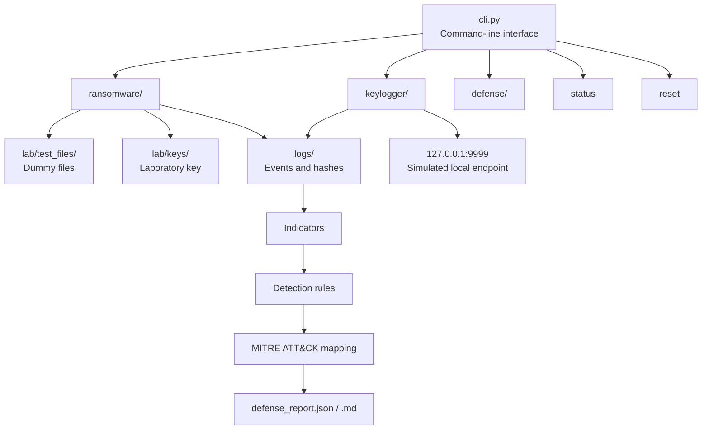
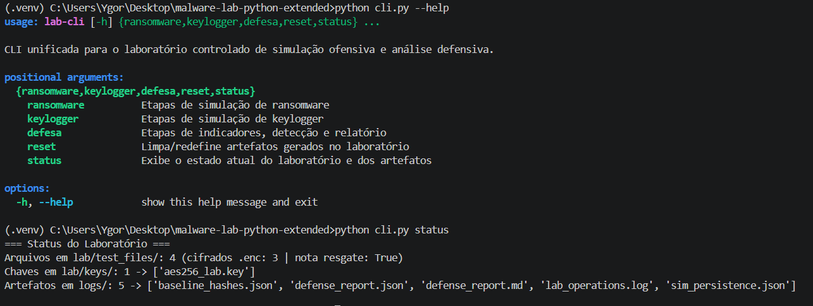
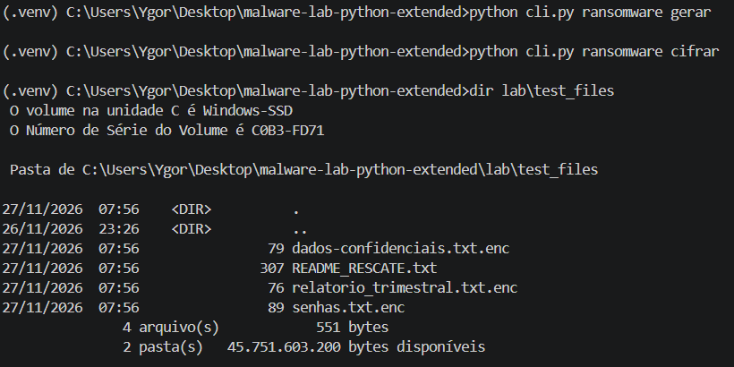
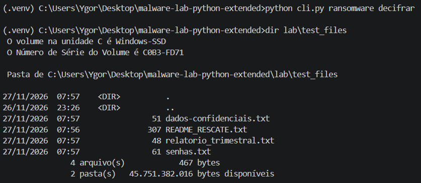
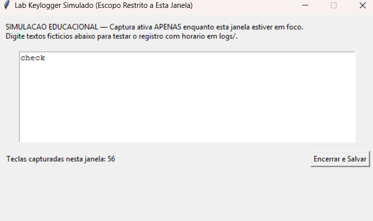

<div align="center">

# Malware Lab Python

**Controlled laboratory for malware behavior simulation, indicator collection, and defensive analysis with MITRE ATT&CK mapping.**


<a href="README-pt-br.md">Português</a> | <b>English</b>

</div>

---

## Overview

**Malware Lab Python** is an educational project developed to study behaviors associated with threats such as ransomware and keyloggers in a controlled environment. The laboratory combines activity simulations, log generation, indicator extraction, and detection rules that map observed behaviors to techniques from the **MITRE ATT&CK** framework.

The goal is to walk through the lifecycle of an analysis exercise: preparing dummy files, executing laboratory-restricted simulations, observing the produced artifacts, and generating a defensive report with alerts, severities, and mitigation recommendations.

The project is built in Python and organized into independent modules, with a command-line interface (CLI) to centralize operations.

> **Security notice:** this repository is intended exclusively for study and demonstration in an authorized environment. Ransomware routines operate solely on dummy files in `lab/test_files/`. Keyboard capture occurs only within the application's test window. Network transmission simulation uses `127.0.0.1:9999` by default. Do not use this project on third-party systems, files, or networks.

## Objectives

- Understand the file encryption and restoration workflow using AES-256-GCM.
- Observe how window-restricted keyboard capture generates log artifacts.
- Demonstrate the concept of persistence without modifying actual operating system settings.
- Simulate data transmission to a local laboratory endpoint.
- Extract indicators from logs and artifacts.
- Correlate behaviors with MITRE ATT&CK techniques.
- Produce JSON and Markdown reports with risk levels, evidence, and defensive recommendations.

## Features

### 1. Ransomware Simulation

The `ransomware/` module prepares dummy files and performs an encryption and decryption simulation.

- Generation of test files in `lab/test_files/`.
- Calculation of SHA-256 hashes to establish an integrity baseline.
- Generation and loading of a 256-bit key.
- Authenticated encryption using AES-256-GCM.
- Creation of `.enc` files and a simulated ransom note `README_RESCATE.txt`.
- Restoration of files using the laboratory key.
- Comparison of restored hashes against the `logs/baseline_hashes.json` manifest.
- Logging of operations in `logs/lab_operations.log`.

### 2. Keylogger Simulation

The `keylogger/` module demonstrates keyboard input capture inside a graphical window created specifically for the exercise.

- Keystroke capture only while the test window is in focus.
- Logging of keystrokes with timestamps and window identification.
- Generation of the `logs/keylogger_simulado.txt` file.
- Creation of a JSON artifact conceptually representing persistence, without installing startup mechanisms on the system.
- Simulated transmission of a log sample to a local service, defaulting to `127.0.0.1:9999`.
- Connection failure handling and logging of results in the laboratory log.

### 3. Defensive Analysis and Detection

The `defense/` module consolidates the records produced by the other components.

- Extraction of events by module and action.
- Identification of artifacts related to the simulations.
- Collection of recorded network destinations.
- Correlation of evidence with detection rules.
- Mapping of detections to MITRE ATT&CK techniques.
- Severity classification and calculation of an overall risk level.
- Generation of `logs/defense_report.json` and `logs/defense_report.md` reports.
- Mitigation recommendations associated with triggered rules.

### 4. Unified CLI, Status, and Laboratory Reset

The `cli.py` file centralizes module execution via `argparse`. The `status` command displays the current state of test files, keys, and log artifacts, while the `reset` command allows clearing specific artifact groups and recreating dummy files on demand.

## MITRE ATT&CK Mapping

The implemented rules map simulated behaviors to the following techniques:

| Rule | Technique | ID | Observed Behavior |
|---|---|---|---|
| `DET-RANSOM-001` | Data Encrypted for Impact | `T1486` | `.enc` files, ransom note, or encryption events |
| `DET-KEYLOG-001` | Input Capture: GUI Input Capture | `T1056.002` | Keystroke logging in the test window |
| `DET-PERSIST-001` | Boot or Logon Autostart Execution | `T1547` | Simulated persistence artifact |
| `DET-EXFIL-001` | Exfiltration Over Alternative Protocol | `T1048` | Simulated transmission attempt or occurrence |

This mapping serves as a classification reference for behaviors observed in the laboratory. It does not, by itself, represent a complete implementation of an enterprise detection platform.

## Architecture



### Directory Structure

```text
simulated-ransomware-keylogger-soc-lab-extended/
├── cli.py
├── ransomware/
│   ├── __init__.py
│   ├── file_generator.py
│   ├── key_manager.py
│   ├── encryptor.py
│   └── decrypto.py
├── keylogger/
│   ├── __init__.py
│   ├── capture.py
│   ├── logger.py
│   └── simulator.py
├── defense/
│   ├── __init__.py
│   ├── indicators.py
│   ├── detection.py
│   └── analysis.py
├── lab/
│   ├── keys/
│   └── test_files/
├── logs/
│   ├── baseline_hashes.json
│   ├── lab_operations.log
│   ├── keylogger_simulado.txt
│   ├── sim_persistence.json
│   ├── defense_report.json
│   └── defense_report.md
├── requirements.txt
├── README.md
└── README-pt-br.md
```

Files and directories inside `lab/` and `logs/` are runtime artifacts. Some are created during laboratory usage and may not be present in a clean copy of the repository.

## Technologies and Concepts

| Technology / Concept | Application in Project |
|---|---|
| Python | Implementation of modules and CLI |
| `argparse` | Organization of subcommands and arguments |
| `cryptography` | AES-GCM operations and key generation |
| AES-256-GCM | Authenticated encryption of dummy files |
| SHA-256 | File integrity verification |
| `pathlib` | Path and directory manipulation |
| `logging` / JSON Lines | Traceability of laboratory events |
| `tkinter` | Graphical test interface for restricted capture |
| `socket` | Simulation of communication with local endpoint |
| MITRE ATT&CK | Reference framework for classifying observed techniques |
| Mermaid | Visual architecture representation |

## Requirements

- Python 3.10 or higher.
- `pip` available.
- Windows, Linux, or macOS. The graphical capture interface requires a working Tk/Tkinter installation.
- Execution from the project root directory.

The only external dependency declared in `requirements.txt` is:

```text
cryptography>=42.0.0
```

## Installation

Clone the repository:

```bash
git clone https://github.com/Ygor-Nassif/simulated-ransomware-keylogger-soc-lab-extended.git
cd simulated-ransomware-keylogger-soc-lab-extended
```

Create and activate a virtual environment.

**Windows (PowerShell):**

```powershell
python -m venv .venv
.\.venv\Scripts\Activate.ps1
```

**Windows (Command Prompt):**

```bat
python -m venv .venv
.venv\Scripts\activate
```

**Linux / macOS:**

```bash
python3 -m venv .venv
source .venv/bin/activate
```

Install dependencies:

```bash
python -m pip install --upgrade pip
pip install -r requirements.txt
```

## Usage

Run commands from the root of the repository.

### Check laboratory status

```bash
python cli.py status
```

### Prepare dummy files

```bash
python cli.py ransomware gerar
```

### Generate or verify the laboratory key

```bash
python cli.py ransomware chave
```

### Run the encryption simulation

```bash
python cli.py ransomware cifrar
```

This routine creates `.enc` files and the `README_RESCATE.txt` note inside `lab/test_files/`, using the key stored in `lab/keys/`.

### Restore files and verify integrity

```bash
python cli.py ransomware decifrar
```

Restoration uses AES-GCM and compares the SHA-256 hashes of recovered files against the values recorded in `logs/baseline_hashes.json`.

### Test keystroke logging

```bash
python cli.py keylogger logger
```

This command runs a basic test of the logging module.

### Open the controlled capture window

```bash
python cli.py keylogger captura
```

Type only dummy content into the opened window. Logging occurs only while the test window is in focus. Close it using the **Encerrar e Salvar** (Finish and Save) button.

### Generate persistence artifacts and test local transmission

```bash
python cli.py keylogger simular
```

The simulator writes a JSON artifact in `logs/` and attempts to connect to the default endpoint `127.0.0.1:9999`. If no listener is active on that port, the failure is logged as the simulation result without interrupting the rest of the workflow.

### Extract indicators

```bash
python cli.py defesa indicadores
```

### Run detection rules

```bash
python cli.py defesa detectar
```

### Generate the defensive report

```bash
python cli.py defesa analisar
```

Consolidated reports are saved to:

```text
logs/defense_report.json
logs/defense_report.md
```

### Reset the environment

Recreate dummy files:

```bash
python cli.py reset --arquivos
```

Remove laboratory keys:

```bash
python cli.py reset --chaves
```

Remove logs and reports:

```bash
python cli.py reset --logs
```

Run all reset options:

```bash
python cli.py reset --tudo
```

**Warning:** resetting keys removes the key required to decrypt existing encrypted files. Restore the files before removing the key if you wish to recover the exercise files.

## Recommended Demonstration Workflow

To observe the complete lifecycle and generate evidence for analysis, follow this sequence:

1. Prepare the dummy files.
2. Generate or verify the laboratory key.
3. Run the simulated encryption.
4. Run detection and observe ransomware-related indicators.
5. Restore the files and check integrity results.
6. Open the keylogger window and type dummy data.
7. Run the persistence and local transmission simulator.
8. Regenerate indicators and defensive reports (JSON and Markdown).
9. Review alerts, MITRE ATT&CK techniques, and recommendations in the generated reports.

## Generated Artifacts

| Path | Purpose |
|---|---|
| `lab/test_files/` | Dummy files used in the exercise |
| `lab/keys/aes256_lab.key` | Laboratory AES-256 key |
| `logs/baseline_hashes.json` | Reference SHA-256 hashes |
| `logs/lab_operations.log` | Structured events in JSON Lines format |
| `logs/keylogger_simulado.txt` | Keystrokes recorded in the test window |
| `logs/sim_persistence.json` | Conceptual record of simulated persistence |
| `logs/defense_report.json` | Structured report of indicators, alerts, and recommendations |
| `logs/defense_report.md` | Human-readable Markdown report with executive summary, MITRE mapping, alerts, and recommendations |

## Security and Limitations

This project was built to restrict simulations to the laboratory environment:

- **File scope:** generation, encryption, and restoration routines validate paths to keep operations strictly inside `lab/test_files/`.
- **Keyboard capture:** key events are bound to the Tkinter window created for the exercise; there is no global keystroke hooking.
- **Persistence:** the module generates a demonstrative JSON file. It does not install services, scheduled tasks, or actual startup mechanisms.
- **Network:** the default simulation target is `127.0.0.1:9999` (local machine loopback).
- **Traceability:** relevant operations are logged in `logs/lab_operations.log`.
- **Integrity:** the project uses SHA-256 to compare restored files against the baseline manifest.

This laboratory does not replace a professional EDR, SIEM, or sandbox solution. Detection rules are deterministic and depend on events and artifacts produced by the modules themselves. The MITRE ATT&CK mapping is an analytical association for educational purposes, not a certification of technique coverage.

The generated key is a laboratory key. Keep it safe while you need to decrypt encrypted files and never publish it to public repositories; it is recommended to include `lab/keys/` in `.gitignore`. Before running, maintain backups of any important data and never point the modules at real files.

## Next Steps

Potential enhancements for future versions:

- Implement automated and regression tests to validate paths, cryptography, integrity, detection rules, and risk levels.
- Expand detection scenarios and event correlation.
- Add HTML report export.
- Add sample rules and queries for conceptual integration with SIEM tools.
- Enhance visualization of indicators and alerts.

These items are proposed enhancements and should not be interpreted as already implemented features.

## Demonstration


### CLI and lab status



### Simulated ransomware encryption



### Restoration and integrity



### Controlled keylogger capture and simulation



### Defense report and MITRE ATT&CK techniques


## Author

**Ygor Jianjulio Nassif**

Computer Science student interested in Cybersecurity, malware analysis, offensive security, and Python tool development.

- GitHub: [github.com/Ygor-Nassif](https://github.com/Ygor-Nassif)
- LinkedIn: [linkedin.com/in/ygor-jianjulio-nassif](https://www.linkedin.com/in/ygor-jianjulio-nassif)

---

<div align="center">

Developed for educational purposes, focusing on controlled simulation, behavioral analysis, and cybersecurity learning.

</div>