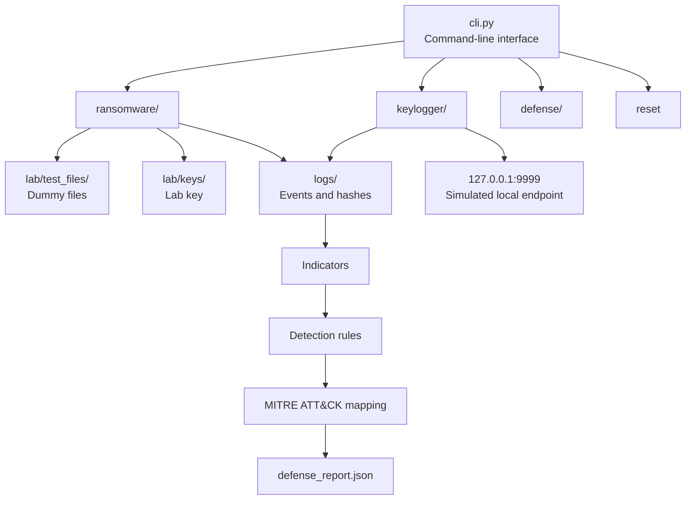

<div align="center">

# Malware Lab Python

**A controlled lab for simulating malware behaviors, collecting indicators, and performing defensive analysis with MITRE ATT&CK mapping.**


[Português](README-pt-br.md) | English

</div>

---

## Overview

**Malware Lab Python** is an educational project built to study, in a controlled environment, behaviors associated with threats such as ransomware and keyloggers. The lab brings together activity simulations, log generation, indicator extraction, and detection rules that map the observed behaviors to techniques from the **MITRE ATT&CK** framework.

The goal is to walk through the full cycle of an analysis exercise: prepare dummy files, run simulations restricted to the lab, observe the artifacts they produce, and generate a defensive report with alerts, severities, and mitigation recommendations.

The project is written in Python and organized into independent modules, with a command-line interface (CLI) that centralizes all operations.

> **Safety notice:** this repository is intended exclusively for study and demonstration in an authorized environment. The ransomware routines operate only on dummy files in `lab/test_files/`. Keystroke capture happens only inside the application's own test window. The simulated data transmission uses `127.0.0.1:9999` by default. Do not use this project on third-party systems, files, or networks.

## Objectives

- Understand the file encryption and restoration workflow using AES-256-GCM.
- Observe how keystroke capture restricted to a single window can generate log artifacts.
- Demonstrate the concept of persistence without changing any real operating system settings.
- Simulate a data transmission to a local lab endpoint.
- Extract indicators from logs and artifacts.
- Correlate behaviors with MITRE ATT&CK techniques.
- Produce a JSON report with risk level, evidence, and defensive recommendations.

## Features

### 1. Ransomware simulation

The `ransomware/` module prepares dummy files and runs an encryption and decryption simulation.

- Generation of test files in `lab/test_files/`.
- SHA-256 hash calculation to establish an integrity baseline.
- Generation and loading of a 256-bit key.
- Authenticated encryption with AES-256-GCM.
- Creation of files with the `.enc` extension and a simulation note, `README_RESCATE.txt`.
- File restoration using the lab key.
- Comparison of restored file hashes against the `logs/baseline_hashes.json` manifest.
- Operation logging to `logs/lab_operations.log`.

### 2. Keylogger simulation

The `keylogger/` module demonstrates keyboard input capture in a graphical window created for the exercise.

- Keystrokes are captured only while the test window is in focus.
- Keystrokes are logged with date, time, and window identification.
- Generation of the `logs/keylogger_simulado.txt` file.
- Creation of a JSON artifact that conceptually represents persistence, without installing any startup mechanism on the system.
- Simulated transmission of a sample of the records to a local service, by default at `127.0.0.1:9999`.
- Handling of connection failures and logging of the result in the lab log.

### 3. Defensive analysis and detection

The `defense/` module consolidates the records produced by the other components.

- Extraction of events by module and by action.
- Identification of artifacts related to the simulations.
- Listing of recorded network destinations.
- Correlation of evidence with detection rules.
- Mapping of detections to MITRE ATT&CK techniques.
- Severity classification and calculation of an overall risk level.
- Generation of the `logs/defense_report.json` report.
- Mitigation recommendations tied to the triggered rules.

### 4. Unified CLI and lab reset

The `cli.py` file centralizes module execution through `argparse`. The `reset` command clears specific groups of artifacts and recreates the dummy files on request.

## MITRE ATT&CK mapping

The implemented rules map the simulated behaviors to the following techniques:

| Rule | Technique | ID | Observed behavior |
|---|---|---|---|
| `DET-RANSOM-001` | Data Encrypted for Impact | `T1486` | `.enc` files, ransom note, or encryption events |
| `DET-KEYLOG-001` | Input Capture: GUI Input Capture | `T1056.002` | Keystroke logging in the test window |
| `DET-PERSIST-001` | Boot or Logon Autostart Execution | `T1547` | Simulated persistence artifact |
| `DET-EXFIL-001` | Exfiltration Over Alternative Protocol | `T1048` | Attempted or completed simulated transmission |

The mapping serves as a classification reference for the behaviors observed in the lab. It does not, by itself, represent a complete implementation of an enterprise detection platform.

## Architecture



### Directory structure

```text
malware-lab-python/
├── cli.py
├── ransomware/
│   ├── __init__.py
│   ├── file_generator.py
│   ├── key_manager.py
│   ├── encryptor.py
│   └── decrypto.py
├── keylogger/
│   ├── __init__.py
│   ├── capture.py
│   ├── logger.py
│   └── simulator.py
├── defense/
│   ├── __init__.py
│   ├── indicators.py
│   ├── detection.py
│   └── analysis.py
├── lab/
│   ├── keys/
│   └── test_files/
├── logs/
│   ├── baseline_hashes.json
│   ├── lab_operations.log
│   ├── keylogger_simulado.txt
│   ├── sim_persistence.json
│   └── defense_report.json
├── requirements.txt
├── README.md
└── README-pt-br.md
```

The files and directories under `lab/` and `logs/` are runtime artifacts. Some are created while the lab is in use and may not be present in a clean copy of the repository.

## Technologies and concepts

| Technology / concept | Use in the project |
|---|---|
| Python | Implementation of the modules and the CLI |
| `argparse` | Organization of subcommands and arguments |
| `cryptography` | AES-GCM operations and key generation |
| AES-256-GCM | Authenticated encryption of the dummy files |
| SHA-256 | File integrity verification |
| `pathlib` | Path and directory handling |
| `logging` / JSON Lines | Traceability of lab events |
| `tkinter` | Test GUI for restricted capture |
| `socket` | Simulated communication with a local endpoint |
| MITRE ATT&CK | Reference for classifying the observed techniques |
| Mermaid | Visual representation of the architecture |

## Requirements

- Python 3.10 or later.
- `pip` available.
- Windows, Linux, or macOS. The graphical capture interface requires a working Tk/Tkinter installation.
- Commands must be run from the project root directory.

The only external dependency declared in `requirements.txt` is:

```text
cryptography>=42.0.0
```

## Installation

Clone the repository:

```bash
git clone <REPOSITORY_URL>
cd malware-lab-python
```

Create and activate a virtual environment.

**Windows (PowerShell):**

```powershell
python -m venv .venv
.\.venv\Scripts\Activate.ps1
```

**Windows (Command Prompt):**

```bat
python -m venv .venv
.venv\Scripts\activate
```

**Linux / macOS:**

```bash
python3 -m venv .venv
source .venv/bin/activate
```

Install the dependencies:

```bash
python -m pip install --upgrade pip
pip install -r requirements.txt
```

## Usage

Run the commands from the repository root.

> **Note:** the CLI subcommands and some generated file names are in Portuguese. Quick reference: `gerar` = generate, `chave` = key, `cifrar` = encrypt, `decifrar` = decrypt, `captura` = capture, `simular` = simulate, `defesa` = defense, `indicadores` = indicators, `detectar` = detect, `analisar` = analyze. For `reset`: `--arquivos` = files, `--chaves` = keys, `--tudo` = everything.

### Prepare the dummy files

```bash
python cli.py ransomware gerar
```

### Generate or verify the lab key

```bash
python cli.py ransomware chave
```

### Run the encryption simulation

```bash
python cli.py ransomware cifrar
```

The routine creates `.enc` files and the `README_RESCATE.txt` note inside `lab/test_files/`. It uses the key stored in `lab/keys/`.

### Restore the files and verify integrity

```bash
python cli.py ransomware decifrar
```

Restoration uses AES-GCM and compares the SHA-256 of the recovered files against the values recorded in `logs/baseline_hashes.json`.

### Test keystroke logging

```bash
python cli.py keylogger logger
```

This command runs a simple test of the logging module.

### Open the controlled capture window

```bash
python cli.py keylogger captura
```

Type only dummy content in the window that opens. Logging occurs only while the test window is in focus. Close it with the **Encerrar e Salvar** (End and Save) button.

### Generate persistence artifacts and test local transmission

```bash
python cli.py keylogger simular
```

The simulator writes a JSON artifact to `logs/` and attempts to connect to the default endpoint `127.0.0.1:9999`. If no receiver is listening on that port, the failure is recorded as a result of the simulation; it does not interrupt the rest of the workflow.

### Extract indicators

```bash
python cli.py defesa indicadores
```

### Run the detection rules

```bash
python cli.py defesa detectar
```

### Generate the defensive report

```bash
python cli.py defesa analisar
```

The consolidated report is saved to:

```text
logs/defense_report.json
```

### Reset the environment

Recreate the dummy files:

```bash
python cli.py reset --arquivos
```

Remove the lab keys:

```bash
python cli.py reset --chaves
```

Remove logs and reports:

```bash
python cli.py reset --logs
```

Run all reset options:

```bash
python cli.py reset --tudo
```

**Warning:** resetting the keys removes the key required to decrypt the existing encrypted files. Restore the files before removing the key if you want to recover the exercise files.

## Recommended demonstration flow

To observe the full cycle and generate evidence for analysis, follow this sequence:

1. Prepare the dummy files.
2. Generate or confirm the lab key.
3. Run the simulated encryption.
4. Run detection and observe the ransomware-related indicators.
5. Restore the files and check the integrity results.
6. Open the keylogger window and type dummy data.
7. Run the persistence and local transmission simulator.
8. Regenerate the indicators and the defensive report.
9. Review the alerts, MITRE ATT&CK techniques, and recommendations in the JSON.

## Generated artifacts

| Path | Purpose |
|---|---|
| `lab/test_files/` | Dummy files used in the exercise |
| `lab/keys/aes256_lab.key` | Lab AES-256 key |
| `logs/baseline_hashes.json` | Baseline SHA-256 hashes |
| `logs/lab_operations.log` | Structured events in JSON Lines |
| `logs/keylogger_simulado.txt` | Entries recorded in the test window |
| `logs/sim_persistence.json` | Conceptual record of simulated persistence |
| `logs/defense_report.json` | Report of indicators, alerts, and recommendations |

## Security and limitations

This project was built to keep the simulations confined to the lab environment:

- **File scope:** the generation, encryption, and restoration routines validate paths to keep operations inside `lab/test_files/`.
- **Keyboard capture:** keyboard events are bound to the Tkinter window created for the exercise; there is no global keystroke capture.
- **Persistence:** the module generates a demonstration JSON file. It does not install services, scheduled tasks, or any real startup mechanism.
- **Network:** the default destination of the simulation is `127.0.0.1:9999`, i.e., the machine's own loopback interface.
- **Traceability:** relevant operations are recorded in `logs/lab_operations.log`.
- **Integrity:** the project uses SHA-256 to compare restored files against the baseline manifest.

The lab is not a substitute for a professional EDR, SIEM, or sandbox solution. The rules are deterministic and depend on the events and artifacts produced by the modules themselves. The MITRE ATT&CK mapping is an analytical association for educational purposes, not a certification of technique coverage.

The generated key is a lab key. Keep it for as long as you need to restore the encrypted files, and do not publish it in public repositories; adding `lab/keys/` to `.gitignore` is recommended. Before running the project, back up any important data, and do not point the modules at real files.

## Next steps

Possible improvements for future versions:

- Implement automated and regression tests covering path validation, cryptography, integrity, detection rules, and risk levels.
- Expand the detection scenarios and event correlation.
- Add report export to HTML or Markdown.
- Add example rules and queries for conceptual integration with SIEM tools.
- Improve the visualization of indicators and alerts.

These items are proposed improvements and should not be read as features that are already implemented.

## Demo

Add real screenshots of the lab to the `images/` folder. Suggestions:

| Suggested file | Content |
|---|---|
| `images/cli-help.png` | CLI help and available subcommands |
| `images/ransomware-encryption.png` | Dummy files before and after encryption |
| `images/integrity-check.png` | Restoration result and SHA-256 verification |
| `images/keylogger-window.png` | Controlled capture window |
| `images/defense-report.png` | Summary of the defensive report and MITRE techniques |

Once the images are added to the repository, they can be embedded here, for example:

```markdown

```

## Author

**Ygor Jianjulio Nassif**

Computer Science student with an interest in cybersecurity, malware analysis, offensive security, and Python tool development.

- GitHub: [add your profile]
- LinkedIn: [linkedin.com/in/ygor-jianjulio-nassif](https://www.linkedin.com/in/ygor-jianjulio-nassif)

---

<div align="center">

Developed for educational purposes, with a focus on controlled simulation, behavior analysis, and cybersecurity learning.

</div>
