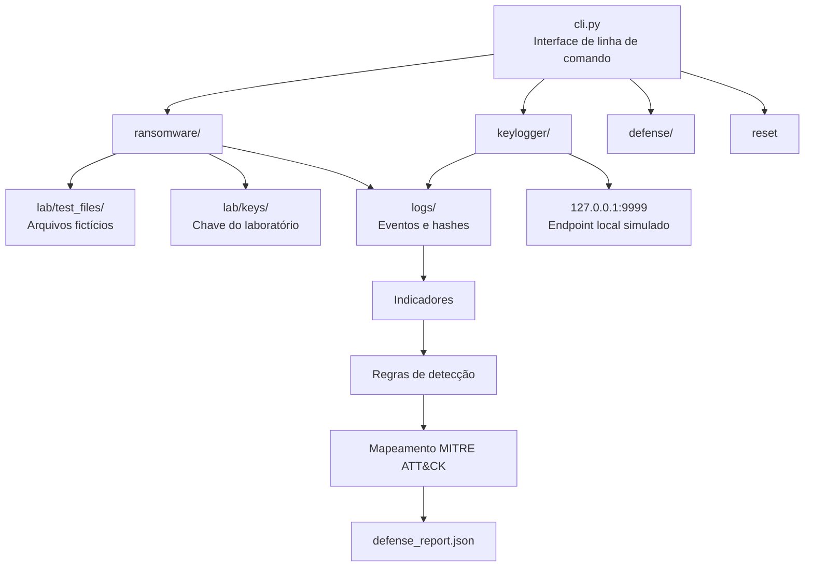
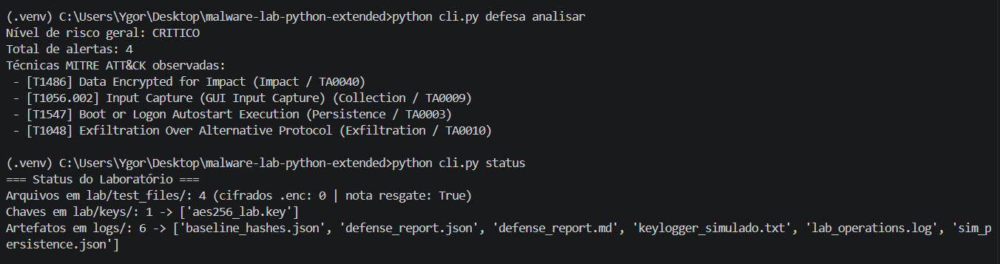

<div align="center">

# Malware Lab Python

**Laboratório controlado para simulação de comportamentos de malware, coleta de indicadores e análise defensiva com mapeamento MITRE ATT&CK.**


</div>

---

## Visão geral

O **Malware Lab Python** é um projeto educacional desenvolvido para estudar, em ambiente controlado, comportamentos associados a ameaças como ransomware e keylogger. O laboratório reúne simulações de atividade, geração de registros, extração de indicadores e regras de detecção que relacionam os comportamentos observados a técnicas do framework **MITRE ATT&CK**.

A proposta é percorrer o ciclo de um exercício de análise: preparar arquivos fictícios, executar simulações restritas ao laboratório, observar os artefatos produzidos e gerar um relatório defensivo com alertas, severidades e recomendações de mitigação.

O projeto foi desenvolvido em Python e organizado em módulos independentes, com uma interface de linha de comando (CLI) para centralizar as operações.

> **Aviso de segurança:** este repositório é destinado exclusivamente a estudo e demonstração em ambiente autorizado. As rotinas de ransomware atuam somente sobre arquivos fictícios em `lab/test_files/`. A captura de teclado ocorre apenas na janela de teste da aplicação. A simulação de transmissão utiliza, por padrão, `127.0.0.1:9999`. Não utilize o projeto em sistemas, arquivos ou redes de terceiros.

## Objetivos

- Compreender o fluxo de cifragem e restauração de arquivos usando AES-256-GCM.
- Observar como uma captura de teclado restrita a uma janela pode gerar artefatos de log.
- Demonstrar, sem alterar configurações reais do sistema operacional, o conceito de persistência.
- Simular uma transmissão de dados para um endpoint local de laboratório.
- Extrair indicadores a partir de logs e artefatos.
- Correlacionar comportamentos com técnicas MITRE ATT&CK.
- Produzir um relatório JSON com nível de risco, evidências e recomendações defensivas.

## Funcionalidades

### 1. Simulação de ransomware

O módulo `ransomware/` prepara arquivos fictícios e realiza uma simulação de cifragem e descriptografia.

- Geração de arquivos de teste em `lab/test_files/`.
- Cálculo de hashes SHA-256 para estabelecer uma referência de integridade.
- Geração e carregamento de chave de 256 bits.
- Cifragem autenticada com AES-256-GCM.
- Criação de arquivos com extensão `.enc` e de uma nota de simulação `README_RESCATE.txt`.
- Restauração dos arquivos usando a chave do laboratório.
- Comparação dos hashes restaurados com o manifesto `logs/baseline_hashes.json`.
- Registro das operações em `logs/lab_operations.log`.

### 2. Simulação de keylogger

O módulo `keylogger/` demonstra a captura de entradas de teclado em uma janela gráfica criada para o exercício.

- Captura de teclas somente enquanto a janela de teste está em foco.
- Registro das teclas com data, hora e identificação da janela.
- Geração do arquivo `logs/keylogger_simulado.txt`.
- Criação de um artefato JSON que representa conceitualmente persistência, sem instalar mecanismos de inicialização no sistema.
- Simulação de transmissão de uma amostra de registros para um serviço local, por padrão em `127.0.0.1:9999`.
- Tratamento de falhas de conexão e registro do resultado no log do laboratório.

### 3. Análise e detecção defensiva

O módulo `defense/` consolida os registros produzidos pelos outros componentes.

- Extração de eventos por módulo e por ação.
- Identificação de artefatos relacionados às simulações.
- Levantamento de destinos de rede registrados.
- Correlação de evidências com regras de detecção.
- Mapeamento das detecções para técnicas MITRE ATT&CK.
- Classificação de severidade e cálculo de um nível geral de risco.
- Geração do relatório `logs/defense_report.json`.
- Recomendações de mitigação associadas às regras acionadas.

### 4. CLI unificada e reset do laboratório

O arquivo `cli.py` centraliza a execução dos módulos por meio de `argparse`. O comando `reset` permite limpar grupos específicos de artefatos e recriar os arquivos fictícios quando solicitado.

## Mapeamento MITRE ATT&CK

As regras implementadas relacionam os comportamentos simulados às seguintes técnicas:

| Regra | Técnica | ID | Comportamento observado |
|---|---|---|---|
| `DET-RANSOM-001` | Data Encrypted for Impact | `T1486` | Arquivos `.enc`, nota de resgate ou eventos de cifragem |
| `DET-KEYLOG-001` | Input Capture: GUI Input Capture | `T1056.002` | Registro de teclas na janela de teste |
| `DET-PERSIST-001` | Boot or Logon Autostart Execution | `T1547` | Artefato de persistência simulada |
| `DET-EXFIL-001` | Exfiltration Over Alternative Protocol | `T1048` | Tentativa ou ocorrência de transmissão simulada |

O mapeamento é utilizado como referência de classificação dos comportamentos observados no laboratório. Ele não representa, por si só, uma implementação completa de uma plataforma de detecção corporativa.

## Arquitetura



### Estrutura de diretórios

```text
malware-lab-python/
├── cli.py
├── ransomware/
│   ├── __init__.py
│   ├── file_generator.py
│   ├── key_manager.py
│   ├── encryptor.py
│   └── decrypto.py
├── keylogger/
│   ├── __init__.py
│   ├── capture.py
│   ├── logger.py
│   └── simulator.py
├── defense/
│   ├── __init__.py
│   ├── indicators.py
│   ├── detection.py
│   └── analysis.py
├── lab/
│   ├── keys/
│   └── test_files/
├── logs/
│   ├── baseline_hashes.json
│   ├── lab_operations.log
│   ├── keylogger_simulado.txt
│   ├── sim_persistence.json
│   └── defense_report.json
├── requirements.txt
└── README.md
```

Os arquivos e diretórios em `lab/` e `logs/` são artefatos de execução. Alguns são criados durante o uso do laboratório e podem não estar presentes em uma cópia limpa do repositório.

## Tecnologias e conceitos

| Tecnologia / conceito | Aplicação no projeto |
|---|---|
| Python | Implementação dos módulos e da CLI |
| `argparse` | Organização dos subcomandos e argumentos |
| `cryptography` | Operações AES-GCM e geração de chave |
| AES-256-GCM | Cifragem autenticada dos arquivos fictícios |
| SHA-256 | Verificação de integridade dos arquivos |
| `pathlib` | Manipulação de caminhos e diretórios |
| `logging` / JSON Lines | Rastreabilidade dos eventos do laboratório |
| `tkinter` | Interface gráfica de teste para captura restrita |
| `socket` | Simulação de comunicação com endpoint local |
| MITRE ATT&CK | Referência para classificação das técnicas observadas |
| Mermaid | Representação visual da arquitetura |

## Requisitos

- Python instalado.
- `pip` disponível.
- Windows, Linux ou macOS. A interface gráfica de captura depende de uma instalação funcional do Tk/Tkinter.
- Execução a partir do diretório raiz do projeto.

A única dependência externa declarada em `requirements.txt` é:

```text
cryptography>=42.0.0
```

## Instalação

Clone o repositório:

```bash
git clone <URL_DO_REPOSITORIO>
cd malware-lab-python
```

Crie e ative um ambiente virtual.

**Windows (PowerShell):**

```powershell
python -m venv .venv
.\.venv\Scripts\Activate.ps1
```

**Windows (Prompt de Comando):**

```bat
python -m venv .venv
.venv\Scripts\activate
```

**Linux / macOS:**

```bash
python3 -m venv .venv
source .venv/bin/activate
```

Instale as dependências:

```bash
python -m pip install --upgrade pip
pip install -r requirements.txt
```

## Como executar

Execute os comandos a partir da raiz do repositório.

### Preparar os arquivos fictícios

```bash
python cli.py ransomware gerar
```

### Gerar ou verificar a chave do laboratório

```bash
python cli.py ransomware chave
```

### Executar a simulação de cifragem

```bash
python cli.py ransomware cifrar
```

A rotina cria arquivos `.enc` e a nota `README_RESCATE.txt` dentro de `lab/test_files/`. Ela utiliza a chave armazenada em `lab/keys/`.

### Restaurar os arquivos e verificar integridade

```bash
python cli.py ransomware decifrar
```

A restauração utiliza AES-GCM e compara o SHA-256 dos arquivos recuperados com os valores registrados em `logs/baseline_hashes.json`.

### Testar o registro de teclas

```bash
python cli.py keylogger logger
```

Esse comando executa o teste simples do módulo de registro.

### Abrir a janela de captura controlada

```bash
python cli.py keylogger captura
```

Digite apenas conteúdo fictício na janela aberta. O registro ocorre somente enquanto a janela de teste estiver em foco. Feche pelo botão **Encerrar e Salvar**.

### Gerar artefatos de persistência e testar transmissão local

```bash
python cli.py keylogger simular
```

O simulador grava um artefato JSON em `logs/` e tenta conectar ao endpoint padrão `127.0.0.1:9999`. Se não houver um receptor escutando nessa porta, a falha é registrada como resultado da simulação; isso não interrompe o restante do fluxo.

### Extrair indicadores

```bash
python cli.py defesa indicadores
```

### Executar as regras de detecção

```bash
python cli.py defesa detectar
```

### Gerar o relatório defensivo

```bash
python cli.py defesa analisar
```

O relatório consolidado é salvo em:

```text
logs/defense_report.json
```

### Resetar o ambiente

Recriar os arquivos fictícios:

```bash
python cli.py reset --arquivos
```

Remover as chaves do laboratório:

```bash
python cli.py reset --chaves
```

Remover logs e relatórios:

```bash
python cli.py reset --logs
```

Executar todas as opções de reset:

```bash
python cli.py reset --tudo
```

**Atenção:** o reset de chaves remove a chave necessária para descriptografar os arquivos cifrados existentes. Faça a restauração antes de remover a chave, caso queira recuperar os arquivos do exercício.

## Fluxo recomendado de demonstração

Para observar o ciclo completo e gerar evidências para análise, utilize a seguinte sequência:

1. Prepare os arquivos fictícios.
2. Gere ou confirme a chave do laboratório.
3. Execute a cifragem simulada.
4. Execute a detecção e observe os indicadores relacionados ao ransomware.
5. Restaure os arquivos e confira os resultados de integridade.
6. Abra a janela do keylogger e digite dados fictícios.
7. Execute o simulador de persistência e transmissão local.
8. Gere novamente os indicadores e o relatório defensivo.
9. Revise os alertas, técnicas MITRE ATT&CK e recomendações no JSON.

## Artefatos gerados

| Caminho | Finalidade |
|---|---|
| `lab/test_files/` | Arquivos fictícios utilizados no exercício |
| `lab/keys/aes256_lab.key` | Chave AES-256 do laboratório |
| `logs/baseline_hashes.json` | Hashes SHA-256 de referência |
| `logs/lab_operations.log` | Eventos estruturados em JSON Lines |
| `logs/keylogger_simulado.txt` | Entradas registradas na janela de teste |
| `logs/sim_persistence.json` | Registro conceitual de persistência simulada |
| `logs/defense_report.json` | Relatório de indicadores, alertas e recomendações |

## Segurança e limitações

Este projeto foi construído para restringir as simulações ao ambiente de laboratório:

- **Escopo de arquivos:** as rotinas de geração, cifragem e restauração validam os caminhos para manter as operações dentro de `lab/test_files/`.
- **Captura de teclado:** o evento de teclado é associado à janela Tkinter criada para o exercício; não há captura global de teclas.
- **Persistência:** o módulo gera um arquivo JSON demonstrativo. Não instala serviços, tarefas agendadas ou mecanismos reais de inicialização.
- **Rede:** o destino padrão da simulação é `127.0.0.1:9999`, ou seja, o loopback da própria máquina.
- **Rastreabilidade:** as operações relevantes são registradas em `logs/lab_operations.log`.
- **Integridade:** o projeto utiliza SHA-256 para comparar os arquivos restaurados com o manifesto de referência.

O laboratório não substitui uma solução EDR, SIEM ou sandbox profissional. As regras são determinísticas e dependem dos eventos e artefatos produzidos pelos próprios módulos. O mapeamento MITRE ATT&CK é uma associação analítica para fins educacionais, não uma certificação de cobertura de técnicas.

A chave gerada é uma chave de laboratório. Preserve-a enquanto precisar restaurar os arquivos cifrados e não a publique em repositórios públicos. Antes de executar, mantenha cópias de segurança de quaisquer dados importantes e não direcione os módulos para arquivos reais.

## Próximos passos

Possíveis evoluções para versões futuras:

- Implementar testes automatizados para validação de caminhos, criptografia, integridade e regras de detecção.
- Ampliar os cenários de detecção e a correlação de eventos.
- Adicionar exportação de relatório em HTML ou Markdown.
- Criar testes de regressão para os níveis de risco.
- Adicionar exemplos de regras e consultas para integração conceitual com ferramentas SIEM.
- Melhorar a visualização dos indicadores e alertas.

Esses itens são propostas de evolução e não devem ser interpretados como funcionalidades já implementadas.

## Demonstração

Adicione capturas de tela reais do laboratório na pasta `images/`. Sugestões:

| Arquivo sugerido | Conteúdo |
|---|---|
| `images/cli-help.png` | Ajuda e subcomandos disponíveis na CLI |
| `images/ransomware-encryption.png` | Arquivos fictícios antes e depois da cifragem |
| `images/integrity-check.png` | Resultado da restauração e verificação SHA-256 |
| `images/keylogger-window.png` | Janela de captura controlada |
| `images/defense-report.png` | Resumo do relatório defensivo e técnicas MITRE |

Quando as imagens forem adicionadas ao repositório, elas podem ser incorporadas aqui, por exemplo:

```markdown

```

## Autor

**Ygor Jianjulio Nassif**

Estudante de Ciência da Computação com interesse em Cibersegurança, análise de malware, segurança ofensiva e desenvolvimento de ferramentas em Python.

- GitHub: [adicione seu perfil]
- LinkedIn: [adicione seu perfil]

---

<div align="center">

Desenvolvido para fins educacionais, com foco em simulação controlada, análise de comportamento e aprendizado em cibersegurança.

</div>
